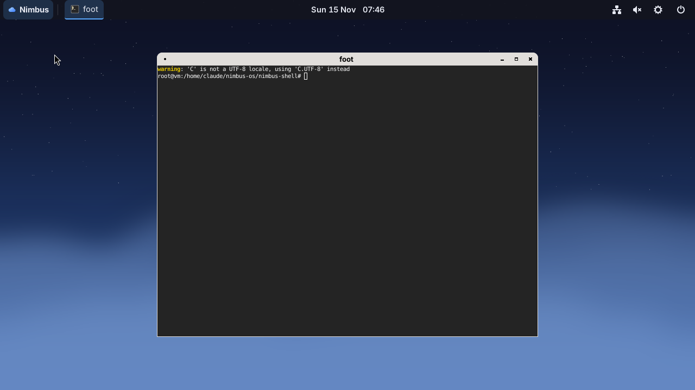
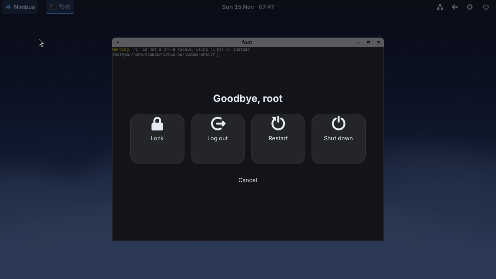

# Nimbus

Nimbus is an Arch-based Linux distribution with its own desktop, **Nimbus Desktop**, written in Rust. It also has a graphical installer that lets you pick which desktop to install.



## What's inside

- **Nimbus Desktop**: [`nimbus-shell`](nimbus-shell/), a Rust/GTK4 shell running on the [labwc](https://labwc.github.io/) Wayland compositor. It includes:
  - a top panel with a launcher button, pinned apps, a window list, a clock and calendar, network/volume/battery indicators and a power button
  - a full-screen app launcher (tap **Super**, then type)
  - a power menu (lock, log out, restart, shut down)
  - Nimbus Settings (dark mode, wallpaper, pinned apps, clock format, shortcuts to display, network and sound tools)
- **Graphical installer**: [Calamares](https://calamares.io), with a **Desktop** page where you choose Nimbus Desktop, KDE Plasma, GNOME, Hyprland or Xfce.
- **Arch Linux underneath**: rolling release, `pacman`, and the AUR if you want it.

| Settings | Power menu |
|---|---|
|  |  |

## Getting the ISO

Every push to `main` builds the ISO with GitHub Actions and publishes it under [Releases](../../releases). Download `nimbus-*.iso` and either:

- **Flash a USB stick** with balenaEtcher, Ventoy, or `sudo dd if=nimbus-*.iso of=/dev/sdX bs=4M status=progress`.
- **Use a VM.** On Apple Silicon, use UTM → *Emulate* → x86_64, 4 GB+ RAM and UEFI. It's slow, but fine for trying it out.

The live system logs straight into Nimbus Desktop. To install, click the cloud icon pinned to the panel, or search "Install".

> Nimbus Desktop is already on the ISO, so it installs offline. The other desktops are downloaded during install, so you'll need internet for those.

## Keyboard shortcuts (Nimbus Desktop)

| Keys | Action |
|---|---|
| Super (tap) / Super+Space | App launcher |
| Super+Enter | Terminal (foot) |
| Super+E | Files (Thunar) |
| Super+B | Firefox |
| Super+I | Nimbus Settings |
| Super+L | Lock screen |
| Super+X | Power menu |
| Super+Q | Close window |
| Super+←/→/↑/↓ | Snap left/right, maximize, minimize |
| Alt+Tab | Switch windows |
| Print / Shift+Print | Screenshot of the screen / a selected area |

Config lives in `~/.config/nimbus/shell.toml` (shell) and `~/.config/nimbus/labwc/` (keybinds, window rules).

## Repository layout

```
nimbus-shell/            Rust source for Nimbus Desktop + its data files
packaging/nimbus-shell/  PKGBUILD for nimbus-shell
packaging/calamares/     PKGBUILD for Calamares (not in official Arch repos)
archiso/                 ISO overlay on top of Arch's "releng" profile
  airootfs/              files added to the live system (installer config, live user, …)
  packages.x86_64        extra packages for the ISO
  build-packages.sh      builds the packages into a local pacman repo
  build-iso.sh           assembles the profile and runs mkarchiso
.github/workflows/       CI that builds and publishes everything
```

### Building locally

You need an x86_64 machine with Docker:

```sh
docker run --rm --privileged -v "$PWD:/nimbus" archlinux:latest \
  bash -c 'bash /nimbus/archiso/build-packages.sh && bash /nimbus/archiso/build-iso.sh'
# → out/nimbus-YYYY.MM.DD-x86_64.iso
```

### Hacking on the shell

```sh
cd nimbus-shell
cargo run -- panel      # or: launcher, power, settings
```

You need GTK 4 and `gtk4-layer-shell`, and you have to run it inside a wlroots-based compositor (labwc, sway, Hyprland, …).

## License

[MIT](LICENSE). Calamares and the Arch packages that make up the ISO keep their own licenses.
