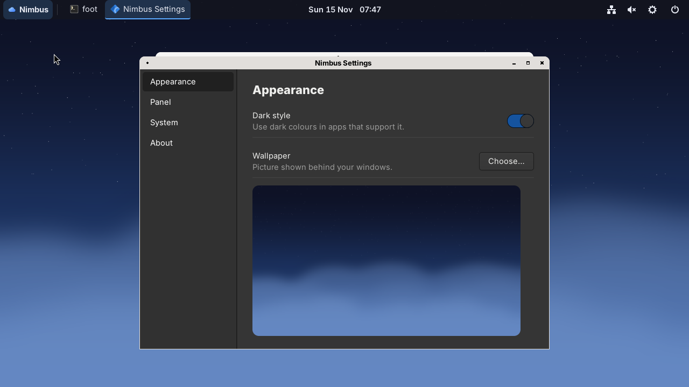

# Nimbus

Nimbus is an Arch-based Linux distribution with its own desktop, **Nimbus Desktop**, written in Rust. It also has a graphical installer that lets you pick which desktop to install.


## What's inside

- **Nimbus Desktop**: [`nimbus-shell`](nimbus-shell/), a Rust/GTK4 shell running on the [labwc](https://labwc.github.io/) Wayland compositor. It includes:
  - a top panel with a launcher button, pinned apps, a window list, a clock and calendar, network/volume/battery indicators and a power button
  - a full-screen app launcher (tap **Super**, then type)
  - a power menu (lock, log out, restart, shut down)
  - Nimbus Settings (dark mode, wallpaper, pinned apps, clock format, shortcuts to display, network and sound tools)
- **Graphical installer**: [Calamares](https://calamares.io), with a **Desktop** page where you choose Nimbus Desktop, KDE Plasma, GNOME, Hyprland or Xfce.
- **Arch Linux underneath**: rolling release, `pacman`, and the AUR if you want it.

| Settings | Power menu |
|---|---|
|  |  |

## Getting the ISO

Every push to `main` builds the ISO with GitHub Actions and publishes it under [Releases](../../releases). Download `nimbus-*.iso` and either:

- **Flash a USB stick** with balenaEtcher, Ventoy, or `sudo dd if=nimbus-*.iso of=/dev/sdX bs=4M status=progress`.
- **Use a VM.** On Apple Silicon, use UTM → *Emulate* → x86_64, 4 GB+ RAM and UEFI. It's slow, but fine for trying it out.

The live system logs straight into Nimbus Desktop. To install, click the cloud icon pinned to the panel, or search "Install".

> Nimbus Desktop is already on the ISO, so it installs offline. The other desktops are downloaded during install, so you'll need internet for those.

## Remote desktop (RDP)

Nimbus Desktop can share its screen over RDP with [`nimbus-rdp`](nimbus-rdp/), a small Rust server built on [IronRDP](https://github.com/Devolutions/IronRDP). It captures the screen through labwc's screen-copy protocol and feeds the remote keyboard and mouse back in through virtual input devices.

1. Open **Nimbus Settings → Remote desktop**, turn it on, set a password, and click **Apply**. The page shows the address to connect to.
2. Connect with:
   - **Windows App** (Microsoft Remote Desktop) on a Mac, iPhone or iPad
   - **Remote Desktop Connection** on Windows
   - **Remmina** or `xfreerdp3` on Linux
3. The first time you connect, accept the certificate. It's self-signed and unique to this computer.

Logins use NLA (CredSSP) with the username and password you set. The server starts again automatically each time you log in. It only shares a session where someone is logged in, and if the screen is locked, the remote side sees the lock screen.

KDE Plasma and GNOME have their own RDP sharing in their system settings. The ISO also includes **Remmina**, so you can connect *from* Nimbus to other computers.

## Updates and the Nimbus package repo

Nimbus has its own signed pacman repository, `[nimbus]`, on top of Arch's repos. It's hosted on this repo's [`repo` release](../../releases/tag/repo). Every installed system has it configured already:

```ini
# /etc/pacman.conf
[nimbus]
SigLevel = Optional TrustedOnly
Include = /etc/pacman.d/nimbus-mirrorlist
```

- Every push to `main` rebuilds the packages (`nimbus-shell`, `nimbus-release`, `calamares`), signs them, and publishes them. That's done by the [repo workflow](.github/workflows/repo.yml). `nimbus-shell` gets a new version (`0.1.0.r<commits>.g<hash>`) on each push, so `sudo pacman -Syu` picks it up.
- `nimbus-release` ships the signing key and `/etc/pacman.d/nimbus-mirrorlist`, so the key and the repo address can be updated like any other package.
- The panel checks for Arch and Nimbus updates every hour and shows a ⟳ count. Click it to update.

Signing key: `089C 4FBE 06D6 C1BF 259E  168C EF84 D5DF 657C 00F4`. Its private half goes in the `NIMBUS_GPG_KEY` Actions secret. Without that secret, packages are published unsigned.

## Keyboard shortcuts (Nimbus Desktop)

| Keys | Action |
|---|---|
| Super (tap) / Super+Space | App launcher |
| Super+Enter | Terminal (foot) |
| Super+E | Files (Thunar) |
| Super+B | Firefox |
| Super+I | Nimbus Settings |
| Super+L | Lock screen |
| Super+X | Power menu |
| Super+Q | Close window |
| Super+←/→/↑/↓ | Snap left/right, maximize, minimize |
| Alt+Tab | Switch windows |
| Print / Shift+Print | Screenshot of the screen / a selected area |

Config lives in `~/.config/nimbus/shell.toml` (shell) and `~/.config/nimbus/labwc/` (keybinds, window rules).

## Repository layout

```
nimbus-shell/            Rust source for Nimbus Desktop + its data files
nimbus-rdp/              Rust RDP server for Nimbus Desktop
packaging/nimbus-shell/  PKGBUILD for nimbus-shell
packaging/nimbus-rdp/    PKGBUILD for nimbus-rdp
packaging/calamares/     PKGBUILD for Calamares (not in official Arch repos)
packaging/nimbus-release/ repo signing key + mirrorlist package
archiso/                 ISO overlay on top of Arch's "releng" profile
  airootfs/              files added to the live system (installer config, live user, …)
  packages.x86_64        extra packages for the ISO
  build-packages.sh      builds the packages into a local pacman repo
  build-iso.sh           assembles the profile and runs mkarchiso
.github/workflows/       CI that builds and publishes everything
```

### Building locally

You need an x86_64 machine with Docker:

```sh
docker run --rm --privileged -v "$PWD:/nimbus" archlinux:latest \
  bash -c 'bash /nimbus/archiso/build-packages.sh && bash /nimbus/archiso/build-iso.sh'
# → out/nimbus-YYYY.MM.DD-x86_64.iso
```

### Hacking on the shell

```sh
cd nimbus-shell
cargo run -- panel      # or: launcher, power, settings
```

You need GTK 4 and `gtk4-layer-shell`, and you have to run it inside a wlroots-based compositor (labwc, sway, Hyprland, …).

## License

[MIT](LICENSE). Calamares and the Arch packages that make up the ISO keep their own licenses.
